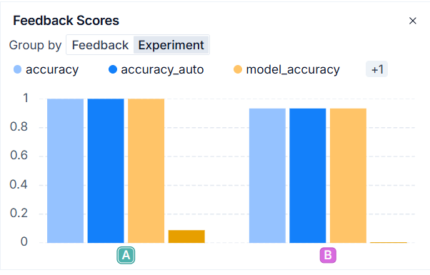

# מיון פניות שירות לקוחות עם LangGraph

מערכת שמקבלת פניית לקוח וממיינת אותה לקטגוריה (`billing`, `shipping`, `technical`, `other`), ומעבירה אותה לצוות המתאים.

## מבנה הגרף

```
START → classify ──(ביטחון ≥ 0.8)──────────────→ handle → END
           │  ▲
           │  └─(ביטחון נמוך, ניסיון ראשון)── לולאה: סיווג מחדש
           └─(ביטחון נמוך אחרי 2 ניסיונות)→ human_review (interrupt) → handle
```

| דרישה | איפה בקוד |
|---|---|
| langgraph | [graph.py](graph.py), `StateGraph` |
| ענף מותנה ולולאה | `route_after_classify`: חוזר ל-`classify` (עד `MAX_ATTEMPTS = 2`), או עובר ל-`handle` או ל-`human_review` |
| interrupt + human-in-the-loop | `human_review` משתמש ב-`interrupt()`. ההרצה ממשיכה עם `Command(resume=...)` ([run_demo.py](run_demo.py)) |
| דאטהסט והערכה ב-LangSmith | [dataset.py](dataset.py), [upload_dataset.py](upload_dataset.py), [evaluate_experiments.py](evaluate_experiments.py) (61 פניות: ברורות, עמומות, בעברית, וכאלה עם כמה נושאים) |

## הרצה

1. יוצרים קובץ `.env` עם `OPENAI_API_KEY`, `LANGSMITH_API_KEY`, `LANGSMITH_TRACING=true` ו-`LANGSMITH_PROJECT`.
2. `python upload_dataset.py` מעלה את הדאטהסט.
3. `python evaluate_experiments.py` מריץ את שני הניסויים.
4. `python run_demo.py` הרצה אינטראקטיבית עם אדם בלולאה.

## הניסוי: לפני ואחרי

- **לפני** (`before-naive-prompt`): קריאה אחת למודל (`gpt-4o-mini`) עם פרומפט נאיבי, רק שמות הקטגוריות. בלי לולאה ובלי אדם.
- **אחרי** (`after-improved-graph`): הגרף המלא עם `PROMPT_V4` (הגדרות לכל קטגוריה וכללי הכרעה לפניות עם כמה נושאים), לולאת סיווג חוזר, ופניות עם ביטחון נמוך עוברות לאדם.

תוצאות (61 פניות, ריצה אחת; בניסוי "אחרי" ריצה אחת מתוך 61 לא נרשמה ב-LangSmith, ולכן n=60):

| מדד | לפני | אחרי |
|---|---|---|
| accuracy (כולל תיקון אדם) | 0.90 | **0.97** |
| model_accuracy (המודל לבדו) | 0.90 | **0.95** |
| reached_human | 0% | 13% |



## תובנה מה-traces

**1. ביטחון גבוה לא אומר שהתשובה נכונה.** ב-trace של ה"לפני" הפנייה "Something is wrong with my order" (אין בה נושא ברור, והתווית היא `other`) סווגה `shipping`. קריאה אחת, בלי שום סימן לכך שהמודל לא בטוח, והמערכת העבירה אותה לצוות המשלוחים. מכיוון שאין בקריאה אחת מנגנון לזהות אי-ודאות, הטעות לא נתפסת.

**2. פרומפט בלי הגדרות מתאים מילות מפתח.** פניות כמו "The site logged me out in the middle of payment" סווגו `billing` בגלל המילה payment, והבעיה האמיתית היא באתר. "The shipping fee in my cart is higher…" סווגה `shipping` בגלל המילה shipping, למרות שמדובר בחיוב. לכן הוספתי הגדרות וכללי הכרעה מפורשים.

ב-trace של ה"אחרי" אותה פנייה ("Something is wrong with my order") מקבלת ביטחון נמוך, עוברת את הלולאה (`classify` פעמיים), מגיעה ל-`human_review` (interrupt) ומקבלת את הקטגוריה הנכונה, `other`.


## מגבלות

- הדאטהסט קטן והתוצאות רועשות. על 45 הפניות הראשונות ה"לפני" כבר היה גבוה (0.93–1.00), ולכן הוספתי 16 פניות עם כמה נושאים (`HARD` ב-[dataset.py](dataset.py)), שבהן ההבדל נראה.
- שלוש פניות עדיין שגויות גם ב"אחרי", ולכן 0.95 ולא 1.00.
- ב-`accuracy` האדם מדומה: הוא תמיד מחזיר את התשובה הנכונה. המדד ההוגן יותר הוא `model_accuracy`.
- כללי ההכרעה ב-`PROMPT_V4` נכתבו אחרי שראיתי את הכשלים בדאטהסט, ולכן יש סיכון ל-overfitting.
