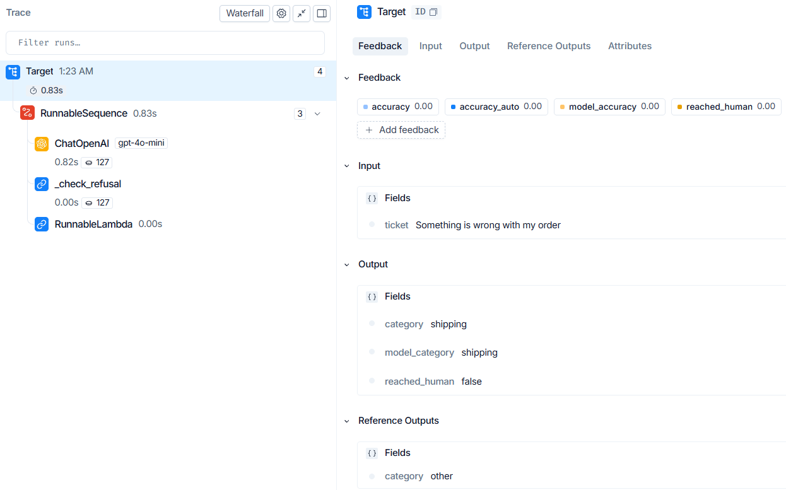
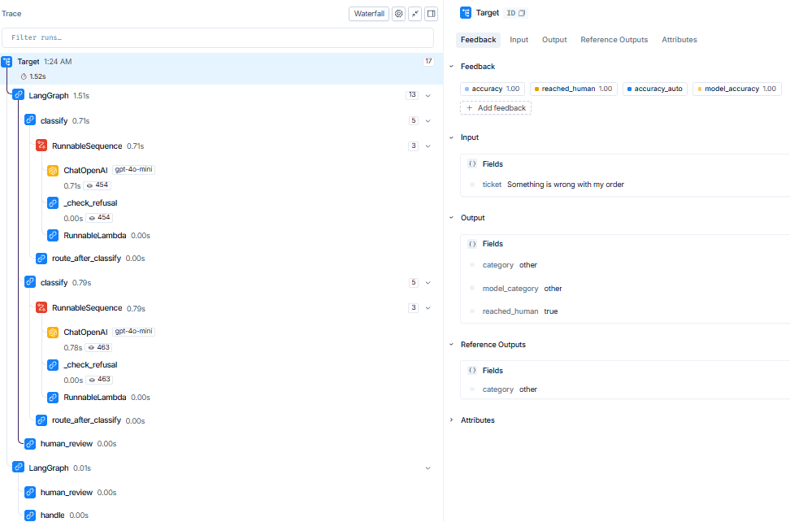

# מיון פניות שירות לקוחות עם LangGraph

מערכת שמקבלת פניית לקוח וממיינת אותה לקטגוריה (`billing`, `shipping`, `technical`, `other`), ומעבירה אותה לצוות המתאים.

## מבנה הגרף

```
START → classify ──(ביטחון ≥ 0.8)──────────────→ handle → END
           │  ▲
           │  └─(ביטחון נמוך, ניסיון ראשון)── לולאה: סיווג מחדש
           └─(ביטחון נמוך אחרי 2 ניסיונות)→ human_review (interrupt) → handle
```

| דרישה | איפה בקוד |
|---|---|
| langgraph | [graph.py](graph.py), `StateGraph` |
| ענף מותנה ולולאה | `route_after_classify`: חוזר ל-`classify` (עד `MAX_ATTEMPTS = 2`), או עובר ל-`handle` או ל-`human_review` |
| interrupt + human-in-the-loop | `human_review` משתמש ב-`interrupt()`. ההרצה ממשיכה עם `Command(resume=...)` ([run_demo.py](run_demo.py)) |
| דאטהסט והערכה ב-LangSmith | [dataset.py](dataset.py), [upload_dataset.py](upload_dataset.py), [evaluate_experiments.py](evaluate_experiments.py) (45 פניות, כולל עמומות ובעברית) |

## הרצה

1. יוצרים קובץ `.env` עם `OPENAI_API_KEY`, `LANGSMITH_API_KEY`, `LANGSMITH_TRACING=true` ו-`LANGSMITH_PROJECT`.
2. `python upload_dataset.py` מעלה את הדאטהסט.
3. `python evaluate_experiments.py` מריץ את שני הניסויים.
4. `python run_demo.py` הרצה אינטראקטיבית עם אדם בלולאה.

## הניסוי: לפני ואחרי

- **לפני** (`before-naive-prompt`): קריאה אחת למודל (`gpt-4o-mini`) עם פרומפט נאיבי, רק שמות הקטגוריות. בלי לולאה ובלי אדם.
- **אחרי** (`after-improved-graph`): הגרף המלא עם `PROMPT_V4` (הגדרות לכל קטגוריה וכללי הכרעה לפניות עם כמה נושאים), לולאת סיווג חוזר, ופניות עם ביטחון נמוך עוברות לאדם.

תוצאות (45 פניות, ריצה אחת):

| מדד | לפני | אחרי |
|---|---|---|
| accuracy (כולל תיקון אדם) | 0.93 | **1.00** |
| model_accuracy (המודל לבדו) | 0.93 | **1.00** |
| reached_human | 0% | 9% |


## תובנה מה-traces

ב-traces של ה"לפני" הכשלים היו בפניות עם **כמה נושאים** באותה פנייה. לדוגמה: "I paid but the website froze and I don't know if the order went through". המודל קיבל החלטה בביטחון גבוה (0.9) והחזיר `billing`, בלי שום סימן שהוא לא בטוח. המסקנה: ביטחון גבוה של המודל לא מעיד על תשובה נכונה, ולכן הוספתי כללי הכרעה מפורשים לפרומפט.

ב-trace של ה"אחרי" רואים שפניות בלי נושא ברור ("Help", "Something is wrong with my order") מקבלות ביטחון נמוך, עוברות את הלולאה ומגיעות לאדם, במקום להיסווג בטעות.




## מגבלות

- הדאטהסט קטן והתוצאות רועשות. ריצה חוזרת של ה"לפני" נתנה בין 0.93 ל-1.00.
- ב-`accuracy` האדם מדומה: הוא תמיד מחזיר את התשובה הנכונה. המדד ההוגן יותר הוא `model_accuracy`.
- כללי ההכרעה ב-`PROMPT_V4` נכתבו אחרי שראיתי את הכשלים בדאטהסט, ולכן יש סיכון ל-overfitting.
